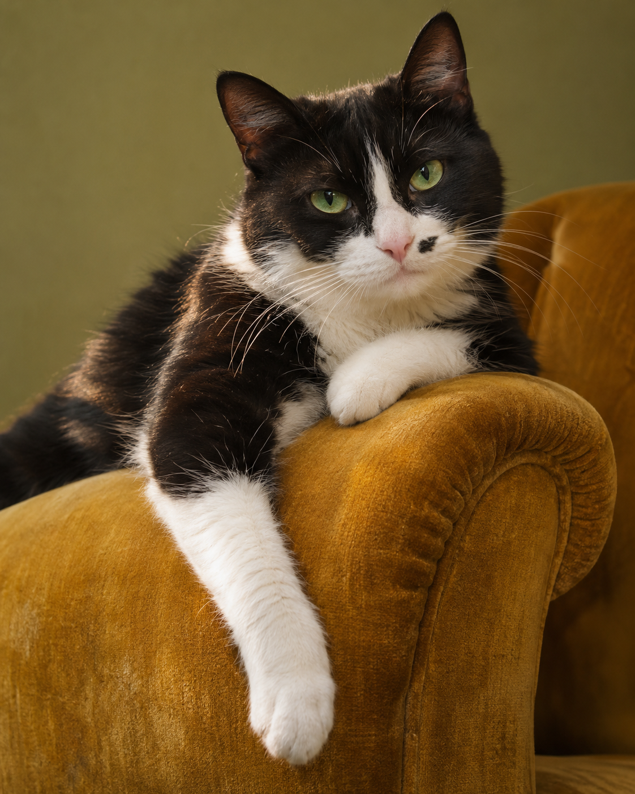
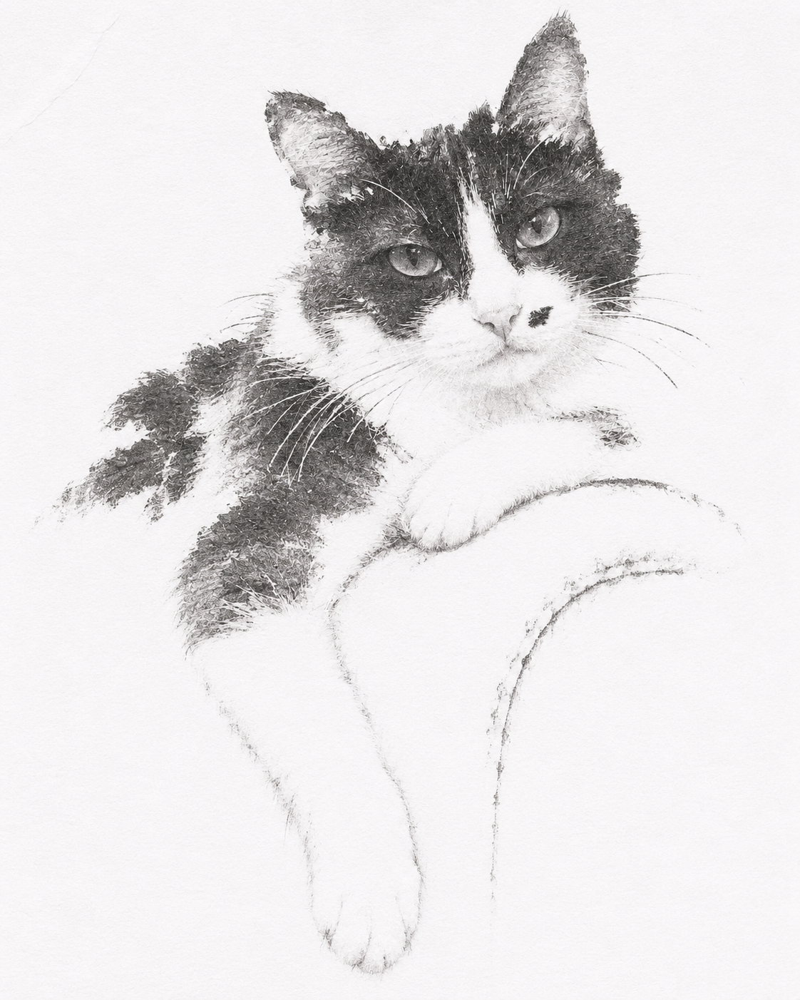
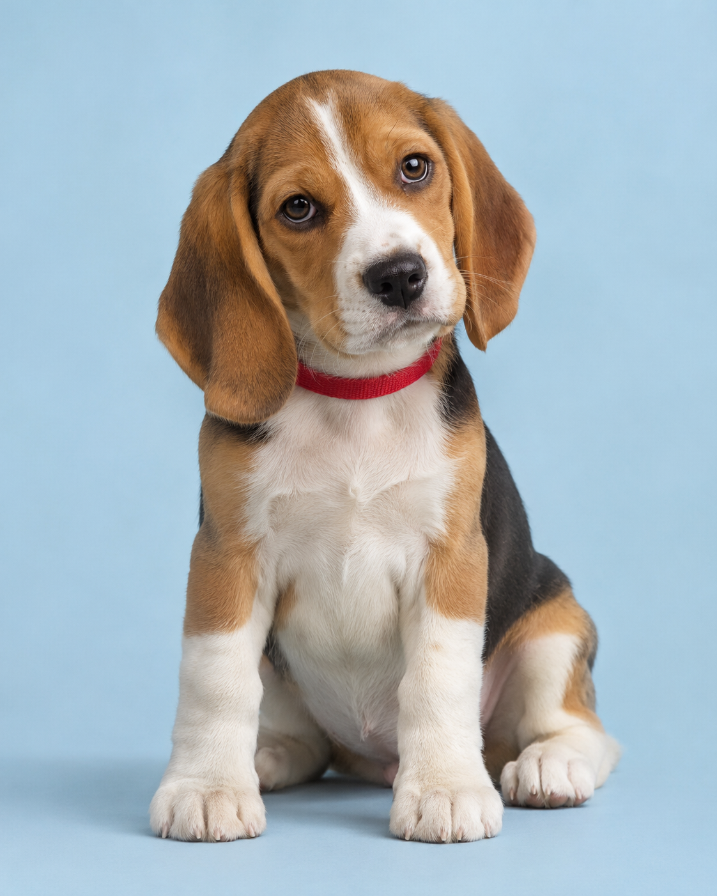
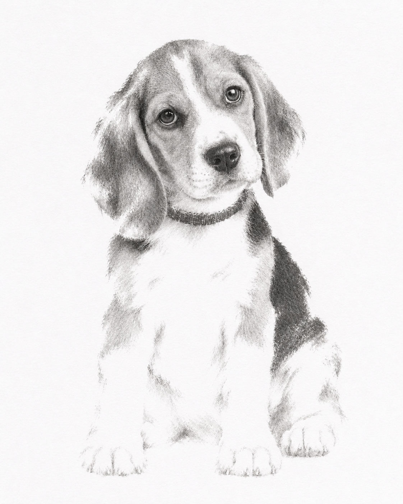
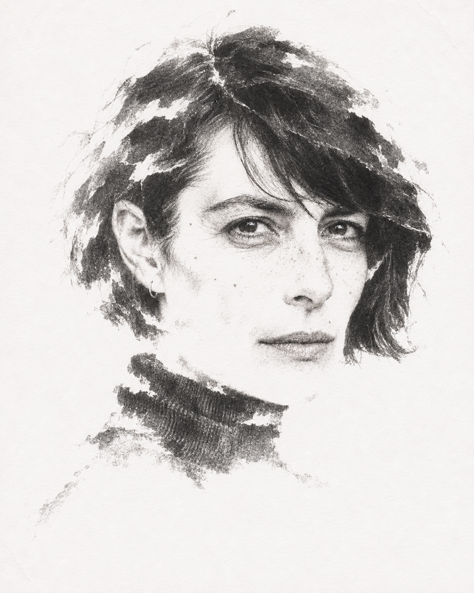
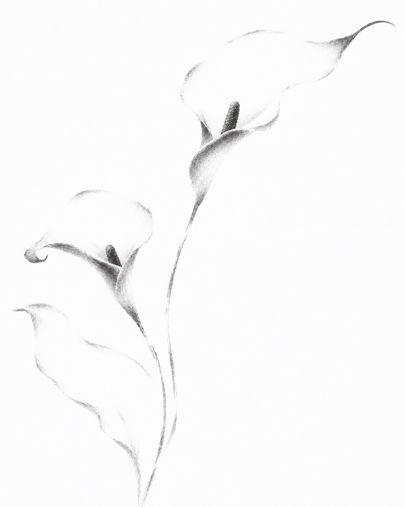
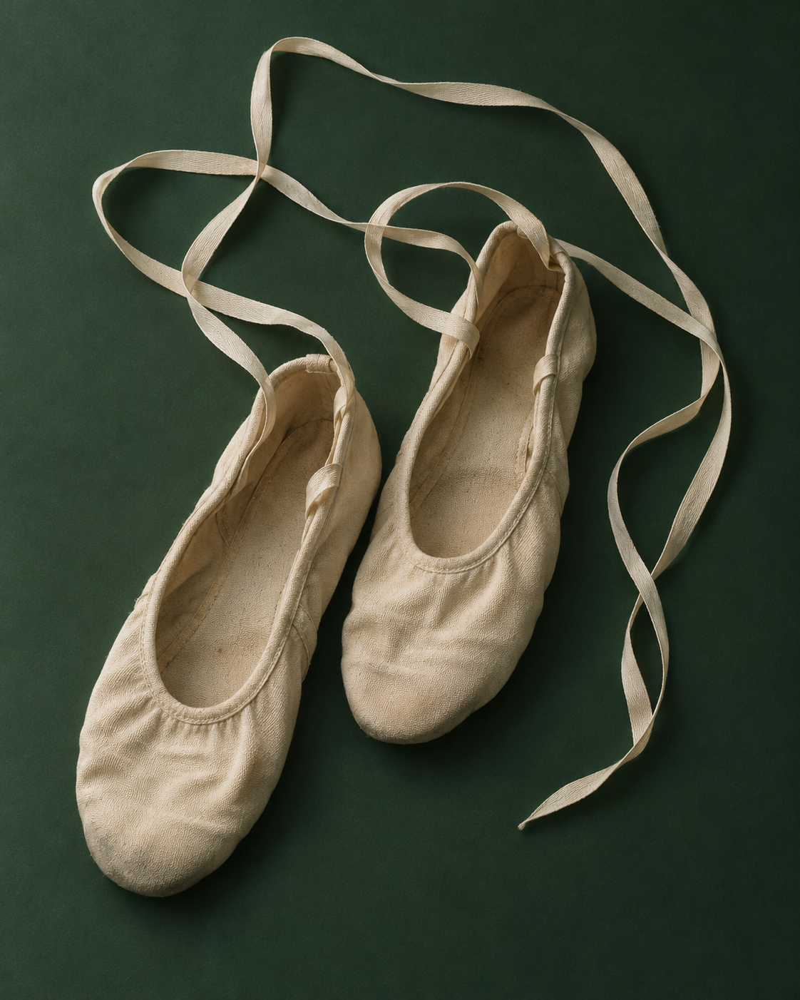
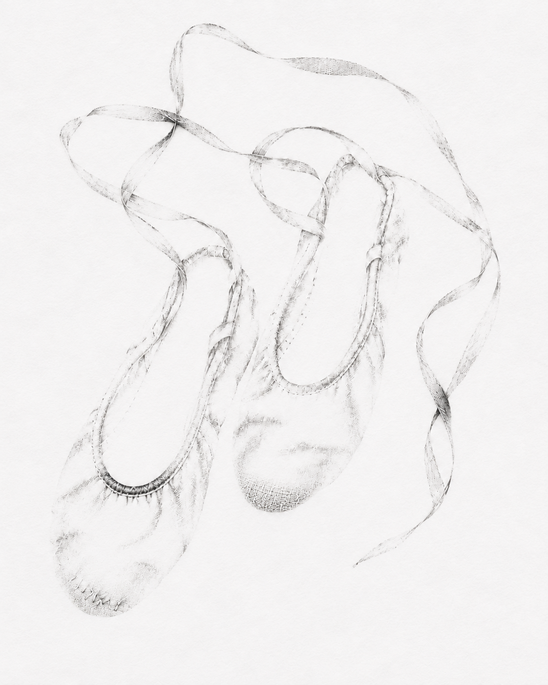
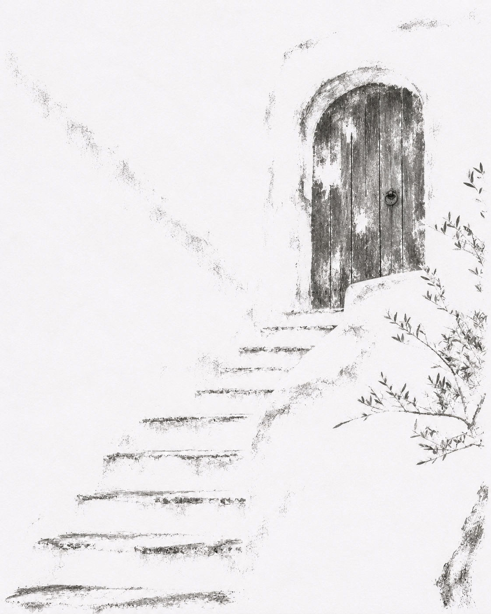

<div align="center">

# 灵魂拓印 · Soul Imprint

**接触没有发生，痕迹却留下了。**

*A contact that never happened. A trace that remains.*

将人、动物、植物、物件与空间，转译为纸上的深浅印痕。

[看效果](#六组接触) · [开始使用](#开始使用) · [作品诠释](#作品诠释) · [Skill 文件](SKILL.md)

</div>

---

## 六组接触

每组左侧为 **AI 生成的摄影输入**，右侧为 **以该输入图实际编辑得到的拓印结果**。人物、动物和地点均为虚构示例。图片保留独立生成文件，可点击查看；精确提示词见 [showcase](showcase/)。

### 01 · 猫 / A familiar gaze

眼神先抵达，轮廓随后消隐。

<table>
<tr><th width="50%">摄影输入 · Input</th><th width="50%">灵魂拓印 · Imprint</th></tr>
<tr><td></td><td></td></tr>
</table>

### 02 · 狗 / A small tilt

垂耳、鼻梁与微微歪起的头，留住一瞬间的神态。

<table>
<tr><th width="50%">摄影输入 · Input</th><th width="50%">灵魂拓印 · Imprint</th></tr>
<tr><td></td><td></td></tr>
</table>

### 03 · 人像 / The remaining presence

面孔仍然鲜明，头发与肩部开始松动。

<table>
<tr><th width="50%">摄影输入 · Input</th><th width="50%">灵魂拓印 · Imprint</th></tr>
<tr><td></td><td></td></tr>
</table>

### 04 · 花卉 / A contour unfolding

宽阔的花瓣退向空白，卷边与弧线留下。

<table>
<tr><th width="50%">摄影输入 · Input</th><th width="50%">灵魂拓印 · Imprint</th></tr>
<tr><td></td><td></td></tr>
</table>

### 05 · 物件 / The body remembers

磨损、褶皱和松弛的系带，为日常留下触感。

<table>
<tr><th width="50%">摄影输入 · Input</th><th width="50%">灵魂拓印 · Imprint</th></tr>
<tr><td></td><td></td></tr>
</table>

### 06 · 空间 / The quiet threshold

墙面撤回，门与台阶仍然指向一个地方。

<table>
<tr><th width="50%">摄影输入 · Input</th><th width="50%">灵魂拓印 · Imprint</th></tr>
<tr><td></td><td></td></tr>
</table>

## 开始使用

这是一个以审美判断和图像编辑流程为核心的 **Agent Skill**。运行环境需要提供可用的生图与图像编辑工具；本仓库不提供独立图像模型。

### 在 Codex 中安装

可以直接向 Codex 发送：

```text
使用 $skill-installer，从 https://github.com/dazhanglang778-cyber/soul-imprint
安装仓库根目录的 skill，名称为 soul-imprint。
```

也可以将仓库克隆到个人技能目录：

```sh
git clone https://github.com/dazhanglang778-cyber/soul-imprint.git ~/.agents/skills/soul-imprint
```

已有同名 skill 时先检查现有版本，避免重复安装。Codex 的本地技能目录与安装方式见 [官方文档](https://learn.chatgpt.com/docs/build-skills)。

### 上传照片，直接说

```text
用 $soul-imprint 处理这张照片。
保留它的神态和辨识特征，让次要部分自然消隐。
```

按需要补充一句即可：

| 想要的变化 | 可以这样说 |
| --- | --- |
| 更容易认出原来的主体 | “清晰一点，保住眼神和花纹。” |
| 更轻、更有空白 | “更轻痕一些，外围多消隐，脸别变。” |
| 换纸色 | “用淡蓝纸和深灰石墨。” |
| 保留有意义的背景 | “牵着的手和窗边都保留。” |
| 做成系列 | “这三张统一纸色、黑度和观看尺度。” |

只有描述也能创作示意。需要保留某个人或宠物的真实特征时，请提供对应照片。

## 它关注什么

- **辨识与消隐的临界点**：保留让主体被认出的特征，允许次要信息缺失。
- **随题材变化的印痕**：物件沿接触边缘，毛发沿生长方向，植物沿脉络，空间沿结构。
- **有层次的留白**：清晰片段、断续碎痕与真正空白共同组织画面。
- **关系的延续**：姿态、目光、连接、互动与必要的背景线索仍然成立。

默认使用“均衡”程度，也可选择“清晰”或“轻痕”。纸色、画幅与消隐程度独立调整。

## 作品诠释

**接触没有发生，痕迹却留下了。**

图像在这里获得一段并未发生过的物质史。

照片中的人、动物与日常物，被转译为仿佛经过按压、摩擦和剥离的印痕。纸面似乎曾经接触过它们，承受过它们的重量，随后又将它们释放。那些断裂、缺印与深浅不一的沉积，成为这场虚构接触的证据。

在这个过程中，图像逐步撤回它的完整性。颜色退去，光泽失效，边界开始松动。主体停留在一个临界状态：已经不足以被完整观看，却依然足以被认出。

一个形象可以失去多少，仍然维持它的在场？

空白由此参与造型。观者以自己的经验接续断裂，使画面中已经消失的部分，再次发生。

“灵魂”，是这种在缺失中仍然持续的作用。

**形体已经撤离，观看仍被它占据。**

## 关于这些样张

六组样张使用内置 image_gen 制作：先生成虚构的摄影输入，再将该输入作为编辑目标转换，未用代码叠加滤镜制作效果图。前后对比展示的是生成式转换，可能发生局部细节偏移；这些样张不构成身份保真或任意照片效果的保证。

“接触”“按压”“拓印”是视觉诠释，作品没有经过真实物理拓印。原始输入、最终结果与精确生成提示词一并保存在 [showcase](showcase/)。

本仓库中的 `SKILL.md` 与 `agents/openai.yaml` 构成技能本体；`showcase/` 用于展示与复现。

---

**Soul Imprint** is an image-making skill for tactile graphite traces, selective disappearance and quiet paper surfaces. It preserves recognizable features while letting secondary information recede. Upload an image and invoke `$soul-imprint` in an environment with image-generation and editing tools. All photographic inputs in this gallery are AI-generated, and each result was edited from its corresponding input.
